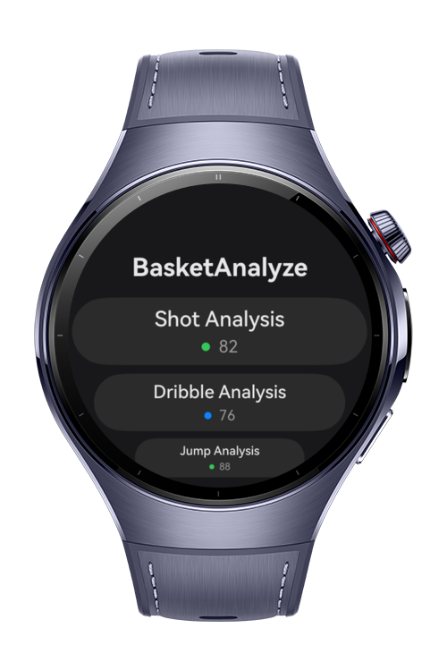
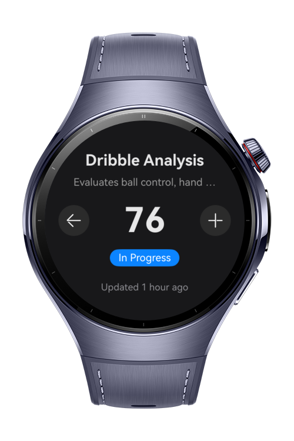
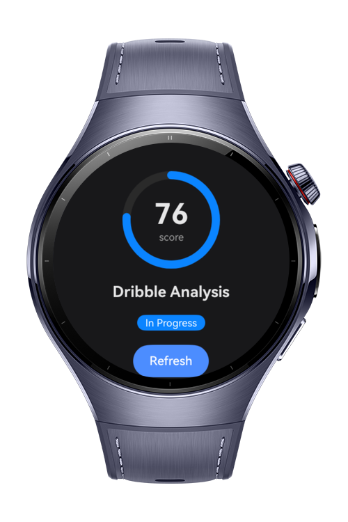
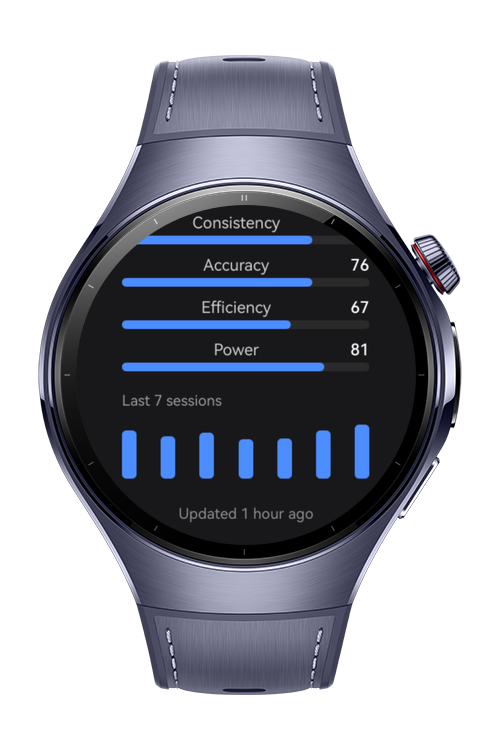

> **Note:** To access all shared projects, get information about environment setup, and view other guides, please visit [Explore-In-HMOS-Wearable Index](https://github.com/Explore-In-HMOS-Wearable/hmos-index).

# How to Build UI Test Suite

A HarmonyOS NEXT smartwatch application that demonstrates how to implement local and instrumented tests in ArkTS projects. Built with ArkTS and ArkUI, the application helps developers efficiently test application logic, user interface components, and navigation flows. It includes instrumented tests for application pages using TestKit APIs such as `UIElementInfo`, `UIEventObserver`, `abilityDelegatorRegistry`, and `Driver`, providing practical examples of how these testing components can be used in a real project.

# Preview

<div>
  
  
  
  
</div>

# Use Cases

* Test custom application pages with instrumented tests.
* Validate application logic and utility functions with local tests.
* Observe instrumented tests in real time and debug test scenarios as they run.
* Use `UIEventObserver` to listen for UI changes and verify expected behavior.
* Customize test execution for specific pages by using `TestRunner`.
* Use `UIElementInfo` to locate and inspect UI components or application windows.
* Define and validate navigation flows across multiple pages.

# Technology

## Stack

* Languages: ArkTS, ArkUI
* Frameworks: HarmonyOS SDK 6.0.1(21)
* Tools: DevEco Studio, Hvigor
* Libraries:
    * `@kit.TestKit`
        * abilityDelegatorRegistry
        * Driver
        * TestRunner/TestAbility
        * ON
        * UIElementInfo
        * UIEventObserver
    * `@ohos/hypium`
        * describe
        * expect
        * it
        * Level
        * beforeEach

# Directory Structure

```
src
├── main
│   ├── ets
│   │   ├── common
│   │   │   └── AnalyzerOptions.ets
│   │   ├── pages
│   │   │   ├── Details.ets
│   │   │   ├── Index.ets
│   │   │   └── Statics.ets
│   │   └── utils
│   │       └── Utils.ets
│   ├── resources
│   └── module.json5
├── ohosTest
│   ├── ets
│   │   ├── test
│   │   │   ├── Details.test.ets
│   │   │   ├── Index.test.ets
│   │   │   ├── List.test.ets
│   │   │   └── Statics.test.ets
│   │   ├── testability
│   │   │   ├── pages
│   │   │   │   └── Index.ets
│   │   │   └── TestAbility.ets
│   │   └── testrunner
│   │       └── OpenHarmonyTestRunner.ets
│   ├── resources
│   │   └── base
│   │       ├── element
│   │       │   ├── color.json
│   │       │   └── string.json
│   │       ├── media
│   │       │   └── icon.png
│   │       └── profile
│   │           └── test_pages.json
│   └── module.json5
└── test
    ├── AnalyzerOptions.test.ets
    ├── List.test.ets
    └── Utils.test.ets
```

# Constraints and Restrictions

## Supported Devices

* Huawei Smart Wearables eg. Huawei Watch 5

## Limitations

* UI test cases require `@ohos/hypium` version `1.0.25`. Make sure this dependency is added to your `oh-package.json5`; otherwise, the tests will not run.

# License

How to Build Modifier Toolkit is distributed under the terms of the MIT License.

See the [LICENSE](LICENSE) file for more information.